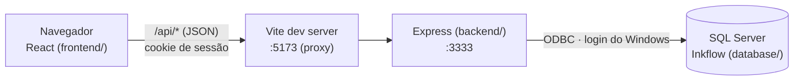

# Inkflow

Plataforma acadêmica para prática de questões do ENADE: banco de questões, correção por IA, comentários de professores e da comunidade, ranking, simulados com timer, mentoria e planos de assinatura.

O repositório é um **monorepo** com uma pasta por camada:

```
Inkflow/
├── frontend/   React 18 + Vite + TypeScript + Tailwind  → o que o navegador exibe
├── backend/    Node.js 22 + Express 5 + TypeScript      → lógica e API REST (/api)
├── database/   SQL Server: scripts 01–08                → modelo, constraints e seed
├── docs/       análise do design no Figma (fora do git)
└── package.json   npm workspaces (frontend + backend)
```

| Pasta | Documentação |
|---|---|
| `frontend/` | [frontend/README.md](frontend/README.md) — telas, rotas, design system, camada `api.ts` |
| `backend/` | [backend/README.md](backend/README.md) — endpoints, sessão, conexão com o banco |
| `database/` | [database/README.md](database/README.md) — modelo, diagrama, ordem dos scripts |

## Como as camadas conversam



- Em desenvolvimento o navegador fala só com o Vite (porta 5173), que repassa `/api` para o Express (porta 3333). É a mesma origem, então o cookie de sessão funciona sem CORS.
- Cada feature do front fala com a API só pelo seu `api.ts` (via `frontend/src/shared/api/http.ts`). Cada módulo do backend em `backend/src/modules/` devolve o formato JSON que esses `api.ts` esperam.

## Pré-requisitos

- **Node.js 22+** e npm.
- **SQL Server** local (testado com o 2025 Developer) e o **ODBC Driver 18 for SQL Server**. O backend conecta com o login do Windows, sem habilitar TCP nem criar usuário com senha.

## Primeira vez

```powershell
npm install                                   # instala frontend e backend (workspaces)
Copy-Item backend/.env.example backend/.env   # depois gere um JWT_SECRET (instruções no arquivo)
```

Banco: rode os scripts `database/01` a `08` na ordem (comandos no [README do banco](database/README.md#ordem-de-execução)). Depois, para as contas de teste conseguirem entrar pela API (a conta admin só é criada se `ADMIN_EMAIL` e `ADMIN_PASSWORD` estiverem no `backend/.env`):

```powershell
npm run db:dev-accounts
```

## Scripts (na raiz)

| Comando | O que faz |
|---|---|
| `npm run dev` | Sobe o **frontend** (http://localhost:5173) e o **backend** (http://localhost:3333/api) juntos |
| `npm run dev:front` / `npm run dev:api` | Só um dos dois |
| `npm run typecheck` | Checa os tipos dos dois projetos |
| `npm run lint` | ESLint do frontend |
| `npm run build` | Build de produção dos dois |
| `npm run db:dev-accounts` | (dev) senhas de teste nas contas do seed + conta admin pelo `.env` |

Para instalar uma dependência num projeto só: `npm install <pacote> -w frontend` ou `-w backend`.

## Situação atual

- **frontend:** completo (perfis aluno, professor e admin; planos; questões; simulados; mentoria; ranking), com os dados vindos da API.
- **database:** scripts 01–08 aplicados no SQL Server local.
- **backend:** todos os módulos prontos (auth, planos, questões, dashboard/ranking, simulados, mentoria, área do professor e admin), e o front já usa a API em todas as telas.
