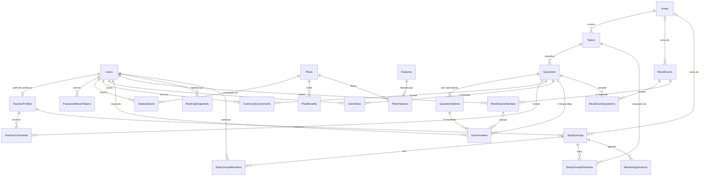

# Banco de dados — Inkflow (SQL Server)

Modelo relacional do Inkflow, a plataforma de prática para o ENADE. Ele foi derivado do front-end: os tipos em `src/features/*/data.ts`, os formulários de cadastro, login, perfil, anotação e comentário, o `AuthContext` e os recursos Pro citados em Planos e no Dashboard.

- **SGBD:** SQL Server 2016 ou superior (usa `AT TIME ZONE` e índices filtrados)
- **Banco:** `Inkflow`
- **Collation:** `Latin1_General_CI_AI`. Ignora maiúsculas e acentos, então buscar "excecoes" encontra "Exceções", como a busca do front.
- **Tabelas:** 24, agrupadas em 6 domínios

---

## Ordem de execução

| # | Arquivo | O que faz |
|---|---|---|
| 1 | `01_create_database.sql` | Cria o banco `Inkflow` com a collation `Latin1_General_CI_AI` |
| 2 | `02_create_tables.sql` | Cria as tabelas (colunas, tipos e nulidade) |
| 3 | `03_constraints.sql` | PK → UNIQUE → FK → CHECK → DEFAULT |
| 4 | `04_indexes.sql` | Índices para FKs e consultas frequentes |
| 5 | `05_seed.sql` | Dados de exemplo baseados nos mocks do projeto |
| 6 | `06_ajustes_pendentes.sql` | Ajustes de modelo exigidos pelas features novas do frontend (ver [Ajustes do frontend](#ajustes-do-frontend-06-e-07)). Exige as variáveis `ADMIN_EMAIL` e `ADMIN_PASSWORD_HASH` (podem ser vazias) |
| 7 | `07_seed_frontend.sql` | Dados de exemplo alinhados aos mocks do front (questões, simulados, anotações, agenda) |
| 8 | `08_alinhar_planos.sql` | Ordem e benefícios dos planos iguais aos da página de Planos; equipe (professor/admin) sem assinatura ativa |

Todos os scripts são **idempotentes**: verificam se cada objeto ou registro já existe antes de criar. Rodar tudo de novo não gera erro nem duplica dados.

### SSMS / Azure Data Studio

Abra e execute cada arquivo na ordem acima. Os arquivos estão em UTF-8. Se os acentos aparecerem quebrados, reabra com *File → Open → Open With… → SQL Query Editor with Encoding → UTF-8*.

### sqlcmd

```bash
sqlcmd -S localhost -E -I -f 65001 -b -i 01_create_database.sql -i 02_create_tables.sql -i 03_constraints.sql -i 04_indexes.sql -i 05_seed.sql
```

Depois rode o `06`, o `07` e o `08` — o `06` precisa das variáveis da conta admin (ver [Ajustes do frontend](#ajustes-do-frontend-06-e-07)):

```powershell
sqlcmd -S localhost -E -C -I -f 65001 -b -i 06_ajustes_pendentes.sql -v 'ADMIN_EMAIL=""' 'ADMIN_PASSWORD_HASH=""'
sqlcmd -S localhost -E -C -I -f 65001 -b -i 07_seed_frontend.sql
sqlcmd -S localhost -E -C -I -f 65001 -b -i 08_alinhar_planos.sql
```

- `-I` liga `QUOTED_IDENTIFIER`. É **obrigatório**, porque há índices filtrados e o `sqlcmd` desliga essa opção por padrão. SSMS, ADO.NET, JDBC e os drivers Node já ligam sozinhos.
- `-f 65001` lê os arquivos como UTF-8 (acentos e símbolos como ✔).
- Para usar o LocalDB, troque `-S localhost` por `-S "(localdb)\MSSQLLocalDB"`.

---

## Diagrama de relacionamentos



### Resumo das cardinalidades

| Tipo | Relacionamento |
|---|---|
| 1:1 | `Users` ↔ `TeacherProfiles` |
| 1:N | `Areas → Topics → Questions → QuestionOptions` · `Plans → PlanBenefits` · `Users → Subscriptions ← Plans` · `Questions → TeacherComments ← TeacherProfiles` (vários professores por questão) · `MockExams → MockExamAttempts` · `StudyGroups → MentoringSessions / StudyGroupPlanItems` |
| N:N | `Plans × Features` (`PlanFeatures`) · `MockExams × Questions` (`MockExamQuestions`) · `StudyGroups × Users` (`StudyGroupMembers`) · `Users × Questions` (via `UserAnswers`, `UserNotes` e `CommunityComments`) |

---

## Tabelas por domínio

### Usuários e autenticação
| Tabela | Origem no front | Observações |
|---|---|---|
| `Users` | `SignupForm`, `PersonalInfoForm`, `NotificationsSection`, `AuthUser` | PK `UNIQUEIDENTIFIER` (`NEWSEQUENTIALID()`), para não expor IDs sequenciais na API. `Role` aceita `aluno` ou `professor`. As notificações por e-mail (padrão 1) e push (padrão 0) ficam aqui. Exclusão lógica via `DeletedAt`. |
| `TeacherProfiles` | `teacher.name/credentials`, selo "Professor verificado" | 1:1 com `Users`. Só quem tem esse perfil pode comentar como professor ou ser mentor. |
| `PasswordResetTokens` | "Esqueceu sua senha?" e "Alterar senha" | Guarda apenas o **hash** do token. |

### Planos e assinaturas
| Tabela | Origem no front | Observações |
|---|---|---|
| `Plans` | `plans/data.ts`, `PlanBanner` | O **Básico é o plano gratuito** (`DailyQuestionLimit = 10`). `NULL` no limite significa ilimitado. |
| `PlanBenefits` | `plan.items[]` | Texto de marketing exibido no card. |
| `Features` / `PlanFeatures` | Recursos Pro (Simulados, Ranking, Mentoria…) | Controle de acesso: o back-end consulta por `Features.Code`. |
| `Subscriptions` | "Plano Grátis", "Faça upgrade" | Guarda o histórico. Um índice único filtrado garante **no máximo 1 assinatura `ativa`** por usuário. `Price` registra o valor contratado. |

**Preços do seed** (fictícios, para uma plataforma que está começando):

| Plano | Preço | Libera |
|---|---|---|
| Básico | Grátis | 10 questões/dia, gabarito IA, professor, comunidade |
| Avançado | R$ 14,90/mês | Tudo do Básico + questões ilimitadas, anotações, histórico completo, ranking |
| Premium | R$ 29,90/mês | Tudo do Avançado + simulados, mentoria, grupo no WhatsApp |

### Banco de questões
| Tabela | Origem no front | Observações |
|---|---|---|
| `Areas` | Filtro "Sua área de TI" e `areaPerformance` | `ShortName` é o rótulo curto do dashboard; `Slug` é usado em `/questoes?area=`. |
| `Topics` | `question.topic` | Único por área. |
| `Questions` | `Question` | `Code` único (`Q2023-112`). `Difficulty` aceita `fácil`, `médio` ou `difícil`. Use `IsActive = 0` em vez de apagar. |
| `QuestionOptions` | `options[]` e `correctOptionId` | Letras de `a` a `e`. Um índice único filtrado permite **exatamente uma** alternativa com `IsCorrect = 1` por questão. |
| `TeacherComments` | Painel "Professor" | 1:N, com no máximo um comentário por professor por questão. |
| `CommunityComments` | Painel "Comunidade" | Não aceita texto vazio. |
| `UserNotes` | `NoteModal` | Uma anotação por usuário por questão (editável). |

### Respostas
| Tabela | Observações |
|---|---|
| `UserAnswers` | Guarda **todas as tentativas** (histórico imutável). A FK composta `(SelectedOptionId, QuestionId)` impede escolher uma alternativa de outra questão. |

### Recursos Pro
| Tabela | Observações |
|---|---|
| `MockExams` / `MockExamQuestions` | Simulados montados a partir do banco de questões. `TimeLimitMinutes` `NULL` significa sem cronômetro. |
| `MockExamAttempts` | Cada realização de um simulado. As respostas ficam em `UserAnswers.MockExamAttemptId`. |
| `RankingSnapshots` | Fotografia do ranking por período (`semanal`/`mensal`). O ranking em tempo real é calculado a partir de `UserAnswers`. |
| `StudyGroups` / `StudyGroupMembers` | Mentoria coletiva e grupo de estudo, com link opcional do grupo de WhatsApp. |
| `StudyGroupPlanItems` | "O especialista define o que e a ordem para estudar". |
| `MentoringSessions` | Encontros agendados. |

---

## Regras de negócio

### Tentativas e limite diário
- Toda resposta gera uma linha em `UserAnswers`, com `AttemptNumber` = 1, 2, 3…
- **Só a primeira tentativa (`AttemptNumber = 1`) conta** para o total de questões respondidas, para o limite diário do plano, para a taxa de acerto e para o ranking.
- Exemplo: você errou e respondeu de novo. O contador do dia continua em 1 se foi sua primeira questão do dia, em 2 se foi a segunda, e assim por diante.
- `AnsweredOn` é a **data local de Brasília**, preenchida por padrão com `AT TIME ZONE 'E. South America Standard Time'`. Ela define o que é "hoje" para o limite e para o streak. As demais datas ficam em UTC.
- A aplicação calcula `AttemptNumber` como `MAX(AttemptNumber) + 1` do par usuário/questão. A constraint `UQ_UserAnswers_User_Question_Attempt` impede duplicidade.

### Exclusão de conta
- O usuário **não é apagado fisicamente**. Ao apagar a conta, a aplicação deve:
  1. Preencher `DeletedAt`.
  2. Anonimizar os dados pessoais (LGPD): `Name = 'Usuário removido'`, `Email = 'removido-<id>@inkflow.invalid'`, e `Phone`, `PhotoUrl` e `Course` como `NULL`.
  3. Cancelar a assinatura ativa.
- Respostas, comentários e o histórico continuam no banco. A interface mostra "Usuário removido" como autor.
- Por usar índice único filtrado (`WHERE DeletedAt IS NULL`), o e-mail fica livre para um novo cadastro.

### Auditoria
- As tabelas principais têm `CreatedAt` e `UpdatedAt` (UTC, com `DEFAULT SYSUTCDATETIME()`).
- **`UpdatedAt` deve ser atualizado pela aplicação** em cada `UPDATE`. Não há triggers.

---

## Consultas úteis (testadas com o seed)

```sql
DECLARE @UserId UNIQUEIDENTIFIER = 'A1000000-0000-0000-0000-000000000001'; -- Maria Clara
DECLARE @Hoje DATE = CONVERT(DATE, SYSDATETIMEOFFSET() AT TIME ZONE 'E. South America Standard Time');

-- Banner "7/10 questões hoje": uso do dia x limite do plano
SELECT p.Name, p.DailyQuestionLimit,
       (SELECT COUNT(*) FROM dbo.UserAnswers ua
         WHERE ua.UserId = @UserId AND ua.AttemptNumber = 1 AND ua.AnsweredOn = @Hoje) AS QuestoesHoje
FROM dbo.Subscriptions s
JOIN dbo.Plans p ON p.Id = s.PlanId
WHERE s.UserId = @UserId AND s.Status = N'ativa';

-- Cards "Questões respondidas" e "Taxa de acerto geral"
SELECT COUNT(*) AS QuestoesRespondidas,
       CAST(100.0 * SUM(CAST(IsCorrect AS INT)) / NULLIF(COUNT(*), 0) AS DECIMAL(5,1)) AS TaxaAcertoPct
FROM dbo.UserAnswers
WHERE UserId = @UserId AND AttemptNumber = 1;

-- Card "Streak de dias seguidos"
WITH Dias AS (SELECT DISTINCT AnsweredOn FROM dbo.UserAnswers WHERE UserId = @UserId),
Grupos AS (
    SELECT AnsweredOn, DATEADD(DAY, -ROW_NUMBER() OVER (ORDER BY AnsweredOn), AnsweredOn) AS Grp
    FROM Dias
)
SELECT TOP (1) COUNT(*) AS StreakAtual
FROM Grupos
GROUP BY Grp
HAVING MAX(AnsweredOn) >= DATEADD(DAY, -1, @Hoje)
ORDER BY MAX(AnsweredOn) DESC;

-- "Meus acertos e erros"
SELECT TOP (5) q.Code, t.Name AS Topico, ua.IsCorrect, ua.AnsweredAt
FROM dbo.UserAnswers ua
JOIN dbo.Questions q ON q.Id = ua.QuestionId
JOIN dbo.Topics t    ON t.Id = q.TopicId
WHERE ua.UserId = @UserId
ORDER BY ua.AnsweredAt DESC;

-- "Desempenho por área"
SELECT a.ShortName AS Area, COUNT(*) AS Questoes,
       CAST(100.0 * SUM(CAST(ua.IsCorrect AS INT)) / COUNT(*) AS INT) AS Percentual
FROM dbo.UserAnswers ua
JOIN dbo.Questions q ON q.Id = ua.QuestionId
JOIN dbo.Topics t    ON t.Id = q.TopicId
JOIN dbo.Areas a     ON a.Id = t.AreaId
WHERE ua.UserId = @UserId AND ua.AttemptNumber = 1
GROUP BY a.ShortName
ORDER BY Percentual DESC;

-- Painel "Comunidade" com autor anonimizado
SELECT CASE WHEN u.DeletedAt IS NULL THEN u.Name ELSE N'Usuário removido' END AS Autor, c.Content
FROM dbo.CommunityComments c
JOIN dbo.Users u ON u.Id = c.UserId
WHERE c.QuestionId = (SELECT Id FROM dbo.Questions WHERE Code = N'Q2022-92')
ORDER BY c.CreatedAt;

-- O usuário tem acesso a um recurso Pro?
SELECT CASE WHEN EXISTS (
    SELECT 1
    FROM dbo.Subscriptions s
    JOIN dbo.PlanFeatures pf ON pf.PlanId = s.PlanId
    JOIN dbo.Features f      ON f.Id = pf.FeatureId
    WHERE s.UserId = @UserId AND s.Status = N'ativa' AND f.Code = N'SIMULADOS'
) THEN 1 ELSE 0 END AS TemAcesso;
```

---

## Dados de exemplo (seed)

- **Usuários**
  - Maria Clara Silva: usuária padrão do Perfil, plano Básico.
  - Nicole Silva: Premium.
  - Paula Cunha: Avançado, com uma assinatura Básica cancelada no histórico.
  - Rafael Nunes: Básico.
  - Marcela Guedes: professora verificada e mentora.
  - Uma conta removida, para demonstrar a anonimização.
  - Nenhum usuário do seed consegue fazer login: o `PasswordHash` é fictício.
- **Questões:** as 3 questões reais do mock (Q2023-112, Q2024-80 e Q2022-92), com alternativas, gabarito IA, comentário da professora e comentários da comunidade.
- **Respostas:** datas relativas ao momento da execução. A Maria tem 3 tentativas hoje (errou a Q2024-80 e tentou de novo), mas o limite mostra **2/10**.
- **Recursos Pro:** um simulado cronometrado (30 min) feito pela Nicole, o ranking do mês calculado a partir das respostas, e um grupo de mentoria com trilha de estudo e um encontro agendado.

---

## Ajustes do frontend (`06` e `07`)

Os dois scripts rodam depois do 01–05 e podem ser repetidos sem efeito colateral. Foram validados duas vezes seguidas numa instância LocalDB temporária e **aplicados no SQL Server local em 28/10/2026**, depois de um backup (`Inkflow_antes_06_20261028-1642.bak`, na pasta padrão de backup da instância).

### `06_ajustes_pendentes.sql` — modelo

| # | Ajuste | Por quê (frontend) |
|---|---|---|
| 1 | `CK_Users_Role` passa a aceitar `admin` | Novo perfil de administração do site |
| 2 | `Users.IsActive` + `DeactivatedAt` | O admin desativa e reativa contas (diferente de apagar, que usa `DeletedAt`) |
| 3 | `UserAnswers.AnsweredAsRole` + view `vw_PracticeRanking` + índice filtrado | Professores respondem questões; as respostas são gravadas mas **não entram no ranking**, que usa só `AnsweredAsRole = 'aluno'` |
| 4 | Feature `RANKING_SIMULADOS` (Premium), `RANKING` liberado no Básico, `RankingSnapshots.Scope` (`GERAL`/`SIMULADOS`) no UNIQUE e no índice, textos dos planos | Ranking Geral aberto a todos; Ranking dos Simulados no Premium |
| 5 | Remove `UQ_UserNotes_User_Question` e cria índice comum | Várias anotações por questão |
| 6 | Tabelas `TeacherAvailabilitySlots` e `MentoringRequests` | Horários abertos pelo professor e solicitações de vaga (aceitar/recusar) |
| 7 | `MockExamAttempts.EndsAt` + tabela `MockExamAttemptAnswers` | Simulado salvo durante a prova (retomar depois de recarregar) |
| 8 | Conta admin no seed | Primeiro acesso à área de administração |

**Regra do Ranking Geral** (igual à exibida na tela): cada questão respondida na aba Questões soma **10 pts se acertar e 2 pts se errar**; só a 1ª tentativa de cada questão; simulados não entram. **Ranking dos Simulados:** acertos da melhor tentativa de cada simulado × 10.

### Conta admin sem senha fixa

O script não tem senha nenhuma. E-mail e **hash** da senha entram por variáveis SQLCMD. No PowerShell, use **aspas simples por fora** (senão o PowerShell descarta valores vazios e interpreta o `$` do hash):

```powershell
# Ainda sem backend: pula a conta admin (foi assim que o banco local foi atualizado)
sqlcmd -S localhost -E -C -I -f 65001 -b -i 06_ajustes_pendentes.sql -v 'ADMIN_EMAIL=""' 'ADMIN_PASSWORD_HASH=""'

# Com o backend: cria a conta admin com o hash gerado por ele
sqlcmd -S localhost -E -C -I -f 65001 -b -i 06_ajustes_pendentes.sql -v 'ADMIN_EMAIL="admin@inkflow.com"' 'ADMIN_PASSWORD_HASH="<hash gerado pelo backend>"'
```

- O hash deve ser gerado pelo backend (ex.: bcrypt) — nunca a senha em texto.
- No SSMS, ative *Query → SQLCMD Mode* e declare as duas variáveis com `:setvar` no topo do arquivo antes de executar.
- Sem as variáveis, o `sqlcmd` para com erro; com elas vazias, a conta é pulada; fora do modo SQLCMD, o script detecta o texto não substituído e **não** cria a conta.
- Se já existir uma conta com esse e-mail, nada é alterado (a senha nunca é sobrescrita).
- **Status:** a conta admin ainda **não existe** no banco local — será criada quando o backend gerar o hash.

### `07_seed_frontend.sql` — dados de exemplo iguais aos do front

| O que entra | Detalhe |
|---|---|
| 11 questões novas | Com alternativas, gabarito, explicação da IA e comentário da professora Marcela. O bloco foi **gerado a partir de `frontend/src/features/questions/data.ts`**, então o texto é idêntico ao do front. Total: 14 questões em 14 tópicos. |
| Prof. Ricardo Alves | Segundo professor (`ricardo.alves@email.com`, perfil verificado), dono de parte dos horários. |
| 4 simulados do front | Programação e Engenharia de Software, Infraestrutura/Redes/Dados, Simulado Geral e Simulado relâmpago (2 min). O simulado antigo do 05 continua. |
| Várias anotações | 3 da Paula (2 na mesma questão) e 2 da Nicole. |
| Agenda de mentoria | 11 horários (Marcela e Ricardo, mentoria coletiva e grupo de estudo) com datas **relativas ao dia da execução**, e 2 solicitações da Nicole (1 confirmada, 1 pendente). |

Ficam **só no front** (dados de vitrine): os 14 estudantes fictícios do ranking e o histórico de respostas do front — o banco mantém o histórico do 05.

### Ainda em aberto

- **`StudyGroups` / `StudyGroupMembers` / `StudyGroupPlanItems` / `MentoringSessions`:** não são usados pelo front (a agenda usa `TeacherAvailabilitySlots`/`MentoringRequests`). Decidir se saem ou se viram a "trilha de estudo" do grupo no futuro.

## Observações e próximos passos

- **Anotações:** a feature `ANOTACOES` vale para Avançado e Premium, igual ao front. Professores e admins também anotam (por perfil, não por plano) — regra da aplicação.
- **Busca por palavra-chave:** `LIKE '%termo%'` sobre `Statement` funciona bem para o volume atual. Se o banco de questões crescer, considere o **Full-Text Search** do SQL Server.
- **Tipo de questão:** hoje o `CHECK` aceita apenas `Múltipla escolha`, como no front. Para questões discursivas do ENADE, amplie o `CK_Questions_Type` e crie uma tabela para as respostas em texto.
